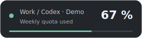
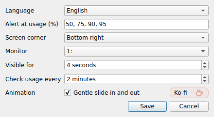

# Quiet Quota

**Small, quiet quota alerts for ChatGPT Work and Codex on Windows.**

Quiet Quota stays in the system tray and shows a short, non-interactive popup
when your weekly usage crosses a threshold. No sound, no repeated reminders,
no model inference. English by default, with eight interface languages.



**v0.2.7 beta · Windows · Python 3.10+ · MIT · Independent community project**

Not affiliated with or endorsed by OpenAI, ChatGPT or Codex. This monitors the
general Work/Codex quota exposed by Codex; it does not claim to track every
ChatGPT model or feature limit.

[German guide](docs/guide-german.md) · [Privacy](PRIVACY.md) · [Changelog](CHANGELOG.md)

## What it does

- Alerts at **50%, 75%, 90% and 95% used** by default. Set your own thresholds.
- Green above 50% remaining, yellow at 50% remaining or less, red at 20% remaining
  or less (50% and 80% used). These colour boundaries remain
  fixed even if you customise the alert thresholds.
- The tray Q ring shows **quota remaining**: 42% used means 58% of the ring is
  coloured. It shrinks as usage increases and refills after a quota reset is read.
  The Q tail keeps the warning colour even at 100% used. Waiting or unavailable
  readings show a neutral grey icon; title-bar and shortcut icons keep the brand mark.
  Popup percentages still mean **used**. Test popups do not alter the live tray icon.
- Each threshold is notified once per quota period, remembered across restarts.
- Jumping across several thresholds produces one popup with the current value.
- Starts silently: your first successful reading establishes the baseline.
- A gentle 28 px slide, four seconds on screen, then disappears.
- Designed to stay above normal windows without taking focus or intercepting clicks.
- Choose any corner and monitor; disable animation or change duration.
- Checks usage every two minutes by default; **polling does not mean a popup**.
- Defers automatic popups when Windows reports fullscreen, presentation or quiet
  states. Detection depends on Windows reporting the application's state.
- Pause from the tray. Quit releases the app's processes; pause only suppresses alerts.
- Optional manual startup shortcut; no automatic startup registration.

## Languages

**English (default), Deutsch, Español, Français, Português, Italiano, 日本語,
简体中文.** Right-click the tray icon → **Settings → Language → Save**.
Selecting a language immediately updates settings, the tray, application error
messages and any visible popup. Save remembers it for future launches; Cancel
or closing Settings restores the previous language everywhere. Changing language
does not trigger a popup or extend its lifetime. Screen corner, monitor and
animation also apply immediately, with Save keeping changes and Cancel restoring
them. Thresholds, display duration and polling interval apply only after Save.
Setup scripts and technical
third-party errors are in English. Translation corrections are welcome.



## Install and try the demo

This beta is a source distribution, **not a standalone EXE**.

1. Download the source ZIP using GitHub **Code → Download ZIP**, or a source
   archive supplied by the maintainer. Extract the complete folder.
2. Install [Python 3.10+ for Windows](https://www.python.org/downloads/windows/)
   with the Python launcher (`py`).
3. Run **`Setup.cmd`**. It creates a local `.venv` and installs PySide6 from PyPI.
   No administrator access is required.
4. Run **`Demo.cmd`**. Find the dark tray icon with a Q ring, possibly under
   the hidden-icons arrow next to the clock. Right-click for test popups and settings.
5. Quit the demo before starting live mode: only one instance runs at a time.

## Connect live usage

Install the **native Windows Codex CLI**, available on `PATH`, and sign in to the
same ChatGPT account/workspace you use for Work/Codex.
See the [official Codex CLI guide](https://developers.openai.com/codex/cli/).
With Node.js installed, the usual setup is:

```powershell
npm install -g @openai/codex
codex login
```

Use ChatGPT sign-in, not an API key. A CLI installed only inside WSL is not used
by this version. Installing the desktop app alone does not guarantee that the
CLI is available on `PATH`.

Run **`Start.cmd`**. Open the tray menu to check your actual percentage and reset
time; choose **Show current usage** to display it. A test popup uses example data
and **does not prove the live connection works**. The first live reading is silent.

If the icon does not appear, use **`Diagnostics.cmd`** to see startup errors. Connection
errors appear in the tray menu and retry with backoff, without popup spam.

## Start with Windows

Create a shortcut to `Start.cmd`, open **Win+R → `shell:startup`**, and place the
shortcut there. Keep the original application folder in place. For a custom shortcut icon, open
its Properties → Change Icon and select `assets/quiet-quota.ico`. Remove the shortcut
to disable auto-start. A desktop shortcut works too.

## Update from v0.1

Quit Quiet Quota from its tray menu. Extract and copy the new project files into
the same application folder, keeping your existing `.venv`. Run `Setup.cmd` if
needed, then `Start.cmd`. Settings and notification history in
`%LOCALAPPDATA%\QuietQuota` are retained. English becomes the initial language if
no previous language preference exists. Select Deutsch in Settings to switch back.
All distributed filenames are English. Recreate any existing desktop or startup
shortcut so it points to `Start.cmd`. Remove the old German launcher files from
your installation folder after updating.

## Data source and privacy

A dedicated local `codex app-server` process provides the documented account and
rate-limit RPCs. Quiet Quota does not start a thread, send a prompt or run inference.
It does not need a local LLM. Codex manages authentication and its service connection.

Only the general `codex` bucket and an explicit **10,080-minute** window are used.
A missing or ambiguous weekly window produces an error, never an invented estimate.
Other per-model buckets are not added together. Protocol changes may need app updates.

See [PRIVACY.md](PRIVACY.md) for local storage and process details.

## Beta test status

- The original popup was tested by the maintainer on Windows and behaved as intended.
- Automated tests cover thresholds, restarts, resets, deferral, parsing and a mocked
  read-only JSONL transport; localisation tests cover all eight languages.
- Qt rendering and UI behaviour are exercised offscreen. This is not a replacement
  for Windows focus, DPI, multi-monitor, font-fallback and fullscreen tests.
- The new multilingual build and a real account's automatic threshold crossing /
  weekly reset still need end-to-end verification. Live account integration is not
  claimed to be verified merely because the demo works.
- Memory use of Qt plus the Codex child process has not been benchmarked.

## Development

```powershell
py -3 -m venv .venv
.venv\Scripts\python -m pip install -r requirements.txt
.venv\Scripts\python -m unittest discover -v
.venv\Scripts\python quiet_quota.py --demo
```

Edit `i18n.py` for translations. Read [CONTRIBUTING.md](CONTRIBUTING.md) before
submitting changes. The core transport makes no inference requests during tests.

## Support

The software is free. Bug reports, translation corrections and test results help.
A small Ko-fi link in Settings opens the support page in your browser only when
clicked. It never appears in quota alerts.
If you find Quiet Quota useful, you can [leave an optional tip on Ko-fi](https://ko-fi.com/st0nks).
There are no paid features or promised support tiers in this beta.

## License

Project code: [MIT](LICENSE). Dependencies retain their own licences; see
[THIRD_PARTY_NOTICES.md](THIRD_PARTY_NOTICES.md).
